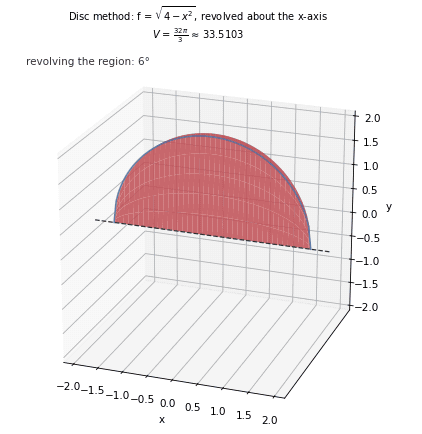
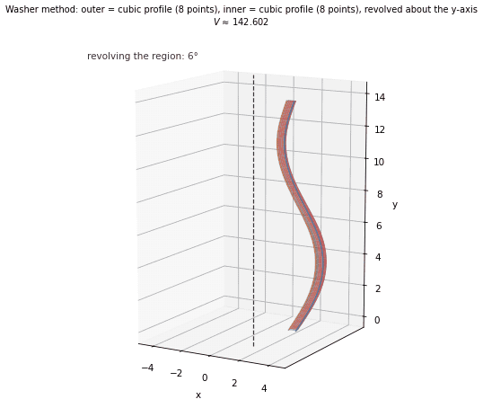

# pydisks

Find the volume or surface area of a shape made by spinning a curve around an axis. Works with formulas (exact answers) or measured points (decimal answers).

<p align="center">
  
</p>

## Install

```bash
pip install pydisks
```

## Formulas

```python
from pydisks import disc, washer, shell, x, y
import sympy as sp

disc(sp.sqrt(4 - x**2), -2, 2)   # sphere -> 32*pi/3
washer(x, x**2, 0, 1)            # between y=x and y=x^2 -> 2*pi/15
shell(x**2, 0, 2)                # about the y-axis -> 8*pi
```

If SymPy can't solve it, add `numeric=True` to get a decimal answer.

## Measured points

```python
from pydisks import Profile, disc, y

heights = [0, 2, 4, 6, 8, 10, 12, 14]
radii   = [3.0, 4.2, 4.8, 4.5, 3.4, 2.4, 2.2, 2.8]
vase = Profile(y, heights, radii, kind="cubic")

disc(vase, 0, 14, axis="y")      # -> 576.78
```

`kind="linear"` connects the points with straight lines. `kind="cubic"` draws a smooth curve through them.

## Pictures and videos

```python
from pydisks import plot_disc, animate_disc

plot_disc(sp.sqrt(4 - x**2), -2, 2)                               # picture
animate_disc(sp.sqrt(4 - x**2), -2, 2).save("sphere.mp4")         # video (needs ffmpeg)
animate_disc(sp.sqrt(4 - x**2), -2, 2).save("sphere.gif", writer="pillow")
```

`plot_washer` and `animate_washer` do the same for washers.

| Sphere | Washer | Vase from measured points |
|:---:|:---:|:---:|
|  |  |  |

## Axis

| Write | Means |
|---|---|
| `"x"` | x-axis |
| `"y"` | y-axis |
| `"x=2"` | the line x = 2 |
| `"y=-1"` | the line y = -1 |

Disc and washer: horizontal axis → write the curve in `x`, vertical axis → in `y`. Shell is the opposite. pydisks won't rearrange your equation for you; it tells you if it's in the wrong variable.

## Errors

Common mistakes raise a clear error instead of a wrong answer: wrong variable, bad bounds, the axis cutting through the shape, or curves that cross. The checks catch most mistakes, not all.

## License

MIT
