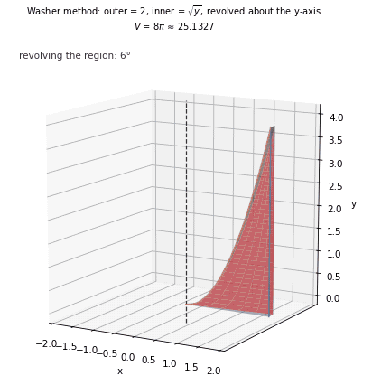

# pydisks

Compute **volumes and surface areas of solids of revolution** — the disc,
washer, and shell methods plus surface area of revolution — symbolically,
using [SymPy](https://www.sympy.org/), or numerically from **measured
data**. Use it to check calculus homework (exact answers like `32*pi/3`) or
to size real objects such as tanks, turned parts and vases from sample
points. Either way, mistakes (wrong variable, self-intersecting solids,
curves in the wrong order) raise clear errors instead of silently returning
a wrong number.

<p align="center">
  
</p>

## Install

```bash
pip install pydisks
```

## Quick start

```python
from pydisks import disc, washer, shell, surface_area, revolve, x, y
import sympy as sp

# Volume of a sphere of radius 2: revolve y = sqrt(4 - x^2) about the x-axis
disc(sp.sqrt(4 - x**2), -2, 2)          # -> 32*pi/3

# Washer: region between y = x and y = x^2 on [0, 1], about the x-axis
washer(x, x**2, 0, 1)                    # -> 2*pi/15

# Shell: revolve y = x^2 on [0, 2] about the y-axis
shell(x**2, 0, 2)                        # -> 8*pi

# Dispatcher: disc if no inner curve, else washer; also gives a float check
revolve(x, 0, 3)                         # -> {'method': 'disc', 'volume': 9*pi, 'approx': 28.27...}
```

## Measured shapes: `Profile`

When a shape comes from measurements rather than a formula, wrap the
sample points in a `Profile` and pass it anywhere a curve is accepted.
The result is then a `float`.

```python
from pydisks import Profile, disc, washer, surface_area, x, y

# A vase: radius (cm) measured at heights (cm) up its vertical axis
heights = [0, 2, 4, 6, 8, 10, 12, 14]
radii   = [3.0, 4.2, 4.8, 4.5, 3.4, 2.4, 2.2, 2.8]
vase = Profile(y, heights, radii, kind="cubic")   # smooth spline through the points

disc(vase, 0, 14, axis="y")                       # -> 576.78... cm^3 (solid)
inside = Profile(y, heights, [r - 0.5 for r in radii], kind="cubic")
washer(vase, inside, 0, 14, axis="y")             # -> 142.6... cm^3 of material

# A turned part drawn as a polyline is exact with kind="linear" (the default)
part = Profile(x, [0, 1, 3], [1, 2, 2])           # frustum, then a cylinder
disc(part, 0, 3)                                  # -> 32.46... == 7*pi/3 + 8*pi
washer(part, 0.5, 0, 3)                           # -> 30.11... mixed with a formula: 0.5 bore
```

- The first argument says which variable the **positions** are measured
  along, exactly as a formula would be written in `x` or `y`. A Profile
  sampled in the wrong variable raises `VariableMismatchError`; pydisks
  never resamples or inverts your data.
- `kind="linear"` joins the points with straight lines. `kind="cubic"` fits
  a natural cubic spline.
- Bounds must lie inside the sampled range. pydisks will not extrapolate
  past your first or last measurement (`BoundsError`).
- The same geometric checks run numerically on a dense grid. A washer
  whose curves cross, or a shell whose axis cuts the region, raises the
  same errors as it does for formulas.

### Formulas SymPy can't integrate

Some integrals have no closed form. Pass `numeric=True` to any method to
get a high-precision float instead of an `UnevaluatedIntegralError`:

```python
disc(x**x, 1, 2)                                  # UnevaluatedIntegralError
disc(x**x, 1, 2, numeric=True)                    # -> 15.4257331686...
surface_area(sp.sqrt(4 - x**2), -2, 2, numeric=True)  # -> 50.2654... (16*pi)
```

## Visualization

`plot_disc` and `plot_washer` take the same arguments as `disc` and `washer`
and return a [matplotlib](https://matplotlib.org/) figure with two panels:

- **left:** the region, the axis of rotation, its mirror image across the
  axis, and a representative slice with its radius `R` (washer: `R` and `r`);
- **right:** the 3D solid of revolution with that slice highlighted (washers
  show a translucent outer surface so the hole is visible).

```python
import matplotlib.pyplot as plt
from pydisks import plot_disc, plot_washer, x, y
import sympy as sp

plot_disc(sp.sqrt(4 - x**2), -2, 2)                  # sphere
plot_washer(x, x**2, 0, 1, slice_at=0.3)             # slice drawn at x = 0.3
fig = plot_washer(2, sp.sqrt(y), 0, 4, axis="y")     # vertical axis
fig.savefig("washer.png")
plt.show()
```

The figure title shows the exact volume (or `V ≈ …` for a Profile, whose
sample points are drawn on the 2D curve). Inputs are checked exactly as
`disc`/`washer` check them, so bad input raises the same errors. Plotting
also needs **numeric** bounds; symbolic bounds raise `BoundsError`.
matplotlib is installed with pydisks.

### Animations

`animate_disc` and `animate_washer` take the same arguments and produce a
video. First the region sweeps one full turn around the axis, and the solid
builds up behind it. Then the camera orbits the finished solid with the
representative slice highlighted.

```python
from pydisks import animate_disc, animate_washer

anim = animate_disc(sp.sqrt(4 - x**2), -2, 2)
anim.save("sphere.mp4", fps=30)                     # needs ffmpeg
anim = animate_washer(2, sp.sqrt(y), 0, 4, axis="y")
anim.save("washer.gif", writer="pillow", fps=20)    # no ffmpeg needed
# or: plt.show() to watch live (keep a reference to `anim`)
```

| Disc: sphere | Washer: about the y-axis | Washer: measured vase (`Profile`) |
|:---:|:---:|:---:|
|  |  |  |
| `animate_disc(sp.sqrt(4 - x**2), -2, 2)` | `animate_washer(2, sp.sqrt(y), 0, 4, axis="y")` | `animate_washer(vase, inside, 0, 14, axis="y")` |

`sweep_frames` and `spin_frames` (90 each by default) set the length of
each phase. Use `n` and `m` to trade mesh detail for rendering speed: a
default animation takes about 10 seconds to render.
`python3 demo_animations.py` renders a set of examples into `./videos/`,
and `python3 docs/make_readme_gifs.py` regenerates the GIFs above.

## The axis of rotation

The axis is written as a string — either a named axis or a line equation:

| You write | Means | Line |
|-----------|-------|------|
| `"x"`     | the x-axis | y = 0 |
| `"y"`     | the y-axis | x = 0 |
| `"x=2"`   | vertical line | x = 2 |
| `"y=-1"`  | horizontal line | y = -1 |

A bare letter names an axis; an equation is a literal line. Note the
asymmetry this creates: `"x"` is the x-axis (y = 0), but `"x=0"` is the
line x = 0 (the y-axis).

The **variable you write your curve in** is derived from the axis and method:

- disc / washer / surface_area: horizontal axis → `f(x)`; vertical axis → `f(y)`
- shell: horizontal axis → `f(y)`; vertical axis → `f(x)`

If you pass a curve in the wrong variable, pydisks raises `VariableMismatchError`
rather than trying to invert it for you — solving for the right variable is part
of the problem.

## Functions

| Function | Method |
|----------|--------|
| `disc(f, a, b, axis="x", *, numeric=False)` | region between `f` and the axis |
| `washer(outer, inner, a, b, axis="x", *, numeric=False)` | region between two curves; `outer` stays farther from the axis |
| `shell(f, a, b, axis="y", bottom=0, *, numeric=False)` | cylindrical shells; pass `bottom` for a two-curve region |
| `surface_area(f, a, b, axis="x", *, numeric=False)` | surface area of revolution |
| `revolve(f, a, b, axis="x", inner=None, *, numeric=False)` | disc/washer dispatcher; returns `{method, volume, approx}` |
| `Profile(var, positions, values, kind="linear")` | a curve from sample points; usable as any `f`/`outer`/`inner`/`bottom` |
| `plot_disc(f, a, b, axis="x", *, slice_at=None, n=200)` | figure of the disc-method solid |
| `plot_washer(outer, inner, a, b, axis="x", *, slice_at=None, n=200)` | figure of the washer-method solid |
| `animate_disc(f, a, b, axis="x", *, slice_at=None, sweep_frames=90, spin_frames=90, ...)` | animation of the disc-method solid forming and rotating |
| `animate_washer(outer, inner, a, b, axis="x", *, ...)` | animation of the washer-method solid forming and rotating |

Curves may be SymPy expressions (exact result) or `Profile`s (float
result). `numeric=True` gives a float for expressions too.

## Errors

Every error subclasses `RevolutionError`, and messages name the likely fix.
Validation runs before integration:

| Exception | When |
|-----------|------|
| `AxisError` | malformed axis string/pair |
| `VariableMismatchError` | curve or bound in the wrong variable |
| `BoundsError` | non-constant bounds, `a >= b`, or bounds outside a Profile's sampled range |
| `SelfIntersectingSolidError` | the axis passes through the region |
| `CurveCrossingError` | two boundary curves cross or are given in the wrong order |
| `DomainError` | curve discontinuous on `[a, b]` |
| `UnevaluatedIntegralError` | SymPy found no closed form (try `numeric=True`) |
| `ProfileError` | malformed sample data (unsorted, mismatched lengths, NaN, < 2 points) |

**Caveat:** for formulas, the geometric and domain checks use `sp.solve` /
`continuous_domain`, which quietly no-op when the bounds are symbolic or SymPy
can't solve. For Profiles they sample a dense grid, so a crossing narrower than
the grid spacing can slip through. They catch common mistakes, not every edge
case. Treat a returned volume as validated only for numeric bounds.

## Tests

```bash
python3 -m pytest test_main.py -v                  # all tests
python3 -m pytest test_main.py::test_disc_sphere   # a single test
```

## License

MIT — see [LICENSE](LICENSE).
